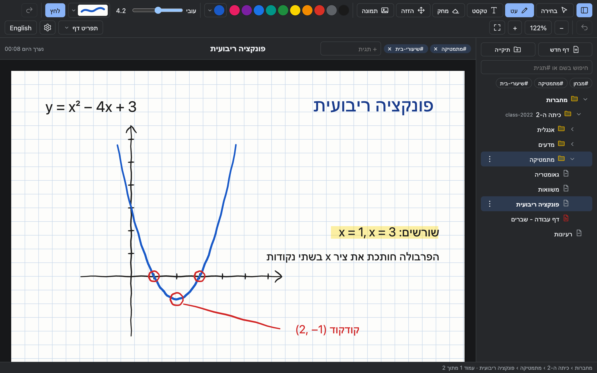

# Coolmus · קולמוס

A pen notebook for Windows, Hebrew first. Every page is an ordinary **PDF file** in your own folders: anyone can open it in any PDF viewer, and in Coolmus its vector ink, text boxes and pictures stay fully editable. You can also write on any other PDF, and bring your OneNote notebooks along.



## Install

On Windows 10 or 11: download the latest **`…_x64-setup.exe`** from [Releases](https://github.com/ariel-bentu/coolmus/releases) and run it. It installs for your user only (no administrator rights), in Hebrew or English, and adds Coolmus to the Start menu; WebView2 is installed if it's missing. The installer isn't signed yet, so Windows may show *"Windows protected your PC"*: click **More info → Run anyway**.

## Features

**Writing and drawing**

- **Hebrew first, right to left.** The interface is in Hebrew with a mirrored right-to-left layout; one click switches to English. Hebrew and English mix freely in names, tags, text boxes and search, and text fields start on the right in Hebrew.
- **Pen input with pressure.** Windows Ink pens report pressure, and it changes the stroke width; the pen's eraser button erases. Every input sample is used, so fast strokes stay smooth and long ones keep up with the pen, and *Stroke smoothing* in Settings evens out a shaky hand and the pen's own jitter on slow lines. Touch pans and pinch-zooms; drawing with a finger can be turned on in Settings.
- **Palm rejection.** While the pen hovers over the screen or touches it, and for a second after, a hand resting on the screen is ignored: it doesn't pan or zoom the page, scroll the folder list, or open pages and menus. A palm that landed before the pen came near has its pan undone; a touch too big for a fingertip is always a palm.
- **Pens.** Ten colors on the toolbar, and the color button opens a panel with 96 more and your last 5 custom colors. Set the width and the style: Solid, Dashed, Dotted, Highlighter (drawn under the ink, 8× wider than its width shows, so switching between pen and highlighter keeps the number) or Pencil.
- **Straight lines.** Draw a roughly straight line and hold the pen still at its end for half a second: it becomes a straight line. Until you lift the pen, its end follows the pen, and a line within 3° of level or upright becomes exactly so. Curves and handwriting are left as drawn.
- **An eraser that erases where it passes.** It cuts strokes at its edge and leaves the rest; passing over a text's letters removes that text box. Each drag is one undo step.
- **Select, move, resize.** With the **Select** tool, tap an item or drag a rectangle around several, then move, resize (corner handle), duplicate or delete them. With something selected, the color, width, style and text-size controls change it.
- **Text boxes.** With the **Text** tool, tap and type; in Hebrew the tap is the box's right edge. Each paragraph follows its own language. While you type, the toolbar shows the box's color and size, and changing them changes the text; drag the ✥ handle at the box's corner to move it. Double-tap a text box (Select tool) to edit it again.
- **Pictures** from a file or the photo gallery, the camera, the clipboard (Ctrl+V), or dropped on the page. Large photos are scaled down so files stay small.
- **A4 sheets, several per file.** *Add page*, under the last sheet or in the page menu, adds a sheet and glides to it with the gap between the sheets in view; each sheet is a page in the PDF and in print. Ink stays on the paper and the page never grows by itself; scrolling stops at the first sheet's top and the last sheet's bottom. Blank, Lined, Grid or Dotted paper.
- **Write on any PDF.** Other PDFs in your folders (worksheets, scans, slides) open with their pages as the paper. What you add is a layer on top: the PDF's own content never changes, and everyone still sees the PDF with your notes in any viewer.

**Pages and folders**

- **New pages and folders,** with the buttons at the top of the sidebar: the line above them, *Create in: …*, names the folder they go in (click it to show that folder), and a new page or folder is scrolled to and flashed in the list.
- **Your folders, as they are on disk.** Add one or more folders (for example `Documents\Coolmus` and a folder inside OneDrive); the sidebar shows their real subfolders and files. A folder can also show its contents directly at the top of the list, without its own row.
- **Everything in reach.** Hovering over a folder or file shows a ⋮ button (new page, new folder, rename, delete for folders; print, open, copy, move, rename, delete for files); right-click has the full menu. Every menu has an ✕, so a pen never needs right-click or Esc.
- **Move and copy.** Drag pages and folders between any of your folders. Copy (Ctrl+C) a page or folder and paste it in File Explorer, or copy files there and paste them here; drag files or whole folders from Explorer onto a folder to copy them in. Deleted items go to the Recycle Bin.
- **Your order.** Folders and pages are listed alphabetically until you order them: *Move up* / *Move down* in their ⋮ or right-click menu (folders among folders, pages among pages). The folders you added can be reordered the same way, or in Settings.
- **Calculated folder labels.** A folder can keep a fixed name (for example `class of 2021`) and show a label calculated from the date: `כיתה ג-3` this school year, `כיתה ד-3` from next September. See below.
- **Tags and search.** Add tags to a page (existing ones are suggested) and search by name and `#tag` together, for example `bridge #work`.
- **Import from OneNote,** several notebooks or sections at once, with progress as it goes. See below.
- **Print** a page (Ctrl+P) or all the pages in a folder, through the system print dialog. **Export** a page as a PNG image.

**Around the page**

- **Always saved.** Changes are saved 3 seconds after you stop, and files are written atomically, so a crash never corrupts a page. *Clear page* asks first, and Ctrl+Z brings it back.
- **Updates itself.** When a new version is out, Coolmus offers it; one click saves your page, installs it and restarts.
- **Quick to start.** Coolmus remembers what it read from your PDFs, so it opens fast and rereads only files that changed; when there are many to read (the first time, or after adding a folder) it shows its progress.
- **Where you are.** The status bar shows the page's folder path (with the folders' labels) and *page 2 of 3*; next to the title is when the page was last edited (*today 14:32*, *yesterday*, *3 days ago*, or the date), which changes only when its content does.
- **Picks up where you left off.** Each page reopens at the zoom and position you left it at (remembered on this computer).
- **The time** is on the toolbar, also in full page: handy in a meeting.
- **Room to write.** Drag the sidebar's edge to resize it, hide it with Ctrl+B, or go full page (F) so the whole screen is paper.

### Shortcuts

| Key | Action |
| --- | --- |
| V / P / T / E / H | Select / Pen / Text / Eraser / Pan |
| Delete, Ctrl+D, Ctrl+A | Delete, duplicate, select all |
| Ctrl+Z, Ctrl+Y (or Ctrl+Shift+Z) | Undo, redo |
| Ctrl+V | Paste a picture or text (on the page) |
| Ctrl+C / Ctrl+X / Ctrl+V | Copy / cut / paste files and folders (after clicking in the tree) |
| Ctrl+P | Print the page |
| Ctrl+S | Save now |
| Ctrl+N | New page in the selected folder |
| Ctrl+0 | Fit the page width |
| Ctrl+B | Show or hide the folder list |
| F | Full page on and off |
| Esc | Close a menu, clear the selection, or leave full page |
| Space + drag | Pan |

## Where your pages live

Coolmus shows the folders you add in ⚙ Settings (by default `Documents\Coolmus`), exactly as they are on disk. Nothing is added to them, no index or database: you can copy, back up or reorganize them in Explorer, and Coolmus picks up the changes (it keeps a cache of what it read from the PDFs with its own settings, never in your folders). A folder inside OneDrive is synced by OneDrive. Removing a folder from the list doesn't touch it on disk.

Each page is one file, `<page name>.pdf`, so the page's name is the file's name. It is an ordinary PDF with one PDF page per sheet, drawn as vectors: the paper, the ink (pressure-width strokes as filled outlines), pictures, and text boxes as real, selectable and searchable text with the system font embedded. Inside, as a PDF attachment named `coolmus-page.json`, it carries the page itself:

```jsonc
{
  "format": "coolmus/page", "version": 2,
  "id": "…", "tags": ["work"], "paper": "Grid", "width": 794, "height": 1123, "sheets": 2,
  "strokes": [ { "id": "…", "pen": { "color": {"r":26,"g":115,"b":232,"a":255}, "width": 3, "style": "Solid", "pressure_sensitive": true },
                 "points": [[120.5, 80.25, 0.62], …] } ],          // [x, y, pressure]
  "texts":   [ { "id": "…", "x": 100, "y": 200, "width": 300, "text": "שלום", "size": 20, "color": {…} } ],
  "images":  [ { "id": "…", "x": 0, "y": 0, "width": 320, "height": 200, "src": "data:image/jpeg;base64,…" } ],
  "created": 1760000000000, "modified": 1760000000000
}
```

Coolmus reads the attachment back, so nothing is lost between edits; the drawing is regenerated from it on every save. Coordinates are in pixels at 96 DPI. `width` × `height` is one sheet (A4 is 794 × 1123); the sheets are stacked top to bottom 24 units apart, and all content shares that one coordinate space; ink stays vector data with pressure, never a picture.

**Edited in another program?** The page records a fingerprint of what Coolmus drew. If someone adds comments in Acrobat or otherwise changes the page, Coolmus notices when you open it and asks: open it in your PDF viewer (keeping their changes), or edit it in Coolmus (its next save replaces those changes). Re-saving a page unchanged in Preview or Acrobat is fine.

**Drawing on another PDF.** Opening a PDF Coolmus didn't make shows its pages, as they are, as the sheets; the file isn't touched until you change something. Saving keeps every part of the PDF (its pages, comments, links, attachments) and adds two things: your layer, drawn over each page you drew on, and the page data. Saving again replaces the layer rather than adding another, and Coolmus can always take it off to get the PDF back as it was (that's what it shows under your editable layer). The page data records the size of each of the PDF's pages under `"background"`. Encrypted PDFs can be viewed but not saved.

A folder with a calculated label, or whose contents you've put in your own order, also contains a hidden `.coolmus-folder.json` holding them, so they move and sync with the folder. Items it doesn't list (for example ones added in Explorer) follow, alphabetically.

### Importing from OneNote

Coolmus reads OneNote's own files, so no Microsoft sign-in is needed. To get a notebook from OneDrive: OneDrive on the web offers no *Download* for a notebook itself, but it does for the **folder that contains it**. Select that folder (move the notebook into a folder first if it's at the top level) and choose *Download*. You get a `.zip` with the notebook's `Open Notebook.onetoc2` and one `.one` file per section; unzip it. OneNote for Windows can also export a section or notebook, and the `.one` files OneNote desktop keeps work too.

Right-click a folder → *Import from OneNote…* and pick one or more files: `Open Notebook.onetoc2` for a whole notebook, or `.one` files for single sections. Each becomes its own folder in the folder you chose, named after the notebook or the section file, with a subfolder per section group and section and a page file per page, named after its title. The status bar shows which file is being imported and the page count as it goes; a file that can't be read doesn't stop the others. OneNote's recycle bin is skipped. The import is a copy: the OneNote files are not changed.

- **Ink** becomes ordinary strokes with its color and width; highlighters stay highlighters. OneNote's files don't keep pen pressure, so imported strokes have an even width.
- **Typed text** becomes text boxes at the same places, with its size and color. Tables become one line per row.
- **Pictures** keep their position and size.
- Right-to-left pages, which OneNote stores at negative positions, are moved onto the page.

### Printing

**Print** (Ctrl+P, the page menu, or right-click a page) and **Print the pages in this folder** (right-click a folder) open the system print dialog straight away, with the printer, copies, page range, preview and *Save as PDF*. Each sheet prints as one A4 page (rendered at about 290 dpi); sheets taller than A4, such as long OneNote imports, are split across pages. To print from your PDF viewer instead, use *Open in PDF viewer*.

### Calculated folder labels

Right-click a folder → **Calculated label…**. The only pattern so far is **School class**: choose the grade the class is in *this* school year and its class number, and Coolmus remembers the year the class started first grade. The school year changes on September 1, so the tree shows `כיתה ג-3` until the end of August and `כיתה ד-3` from September. The wording is a template: `{grade}` is the grade letter (א … יב, then `בוגרים` after 12th grade, `גן` before 1st) and `{n}` is the class number. The folder's own name never changes.

## Architecture

Each part of the app is a separate crate. Dependencies point in one direction only.

```
crates/coolmus-core    Pure data model: Page (strokes, text boxes, pictures), Pen, tags & search,
                      hit-testing, input smoothing. No I/O, no UI.
crates/coolmus-render  Stroke → triangle meshes, stroke → outline → PNG (tiny-skia), paper patterns.
crates/coolmus-pdf     Page ⇄ PDF: draws a page as vector PDF (krilla, with bidi text layout),
                      attaches and reads back the page data, detects edits by other programs;
                      adds and removes a page's layer on another PDF (lopdf).
crates/onenote-import OneNote .one / .onetoc2 files → Coolmus pages (via onenote_parser).
crates/coolmus-store   The root folders: tree scan, page files, rename/move/copy/trash, tag index,
                      folder labels.
app/                  Tauri 2 desktop shell (Rust): commands over the crates above, system
                      clipboard file lists, file drops, OneNote import progress, settings.
                      icons/ (icon.svg, generated by feather.py), installer/ (Hebrew installer text).
app/ui/               The interface: plain HTML/CSS/JavaScript with no build step.
                      canvas.js (input, drawing, eraser, selection, text editing), ink.js (stroke
                      geometry, hit-testing, cutting strokes), tree.js (folders), ui.js (menus,
                      dialogs), media.js (pictures and camera), labels.js (calculated folder
                      labels), export.js (PNG and printing), background.js (another PDF under a
                      page, rendered with pdf.js from vendor/pdfjs), i18n.js (Hebrew, English).
.github/workflows/    release.yml: builds and drafts a Windows release for each version tag.
```

`coolmus-core` doesn't depend on any other crate here. The interface only talks to the backend through Tauri commands, and all paths it sends are checked so they can't leave the folders you added.

**Why a web view for the interface?** Rust-native UI toolkits such as egui can't yet lay out right-to-left (bidirectional) text, so Hebrew would render backwards. WebView2 (Chromium, built into Windows 10 and 11) handles Hebrew and RTL fully and supports pen input well.

**Speed.** The page is drawn on two stacked canvases. The base canvas holds the paper, pictures and finished strokes; each stroke is built once as a cached `Path2D`, off-screen strokes are skipped, and the base is redrawn only when you pan, zoom or change the page. The stroke in progress is drawn on a separate canvas in Chromium's low-latency (`desynchronized`) mode. Text boxes are HTML on top, moved with the same transform.

## Building

You need Rust 1.85 or later. On Windows, also install the [WebView2 runtime](https://developer.microsoft.com/microsoft-edge/webview2/); it comes preinstalled on Windows 10 and 11. Node.js isn't needed to build or run the app, only for the interface's tests.

```powershell
cargo run --release -p coolmus        # run
cargo build --release -p coolmus      # target\release\coolmus.exe
cargo test --workspace
node --test "app/ui-tests/*.test.mjs"  # the interface's logic (Node 22 or later)
```

`npm test` runs both. GitHub Actions runs them, with Clippy, on every push to `main` and every pull request.

To build an installer (.msi or setup.exe), install the Tauri CLI with `cargo install tauri-cli --version "^2"`, then run `cargo tauri build` inside `app/`. On a Mac, `scripts/build-windows.sh` cross-compiles the Windows installer (its header lists the one-time setup).

**Releasing a version:** `npm run release -- 0.2.0` (or `npm run release` for the version already in `app/tauri.conf.json`). It sets the version, pushes `main` and a `v0.2.0` tag; GitHub Actions then runs the tests on Windows, builds the installers and attaches them to a draft release to review and publish. `npm run release:watch` follows the build. The other shortcuts in `package.json` (`dev`, `test`, `build:windows`, `push`) are plain cargo and git commands; npm only launches them, and nothing needs installing. The GitHub login needs the `workflow` scope (`gh auth refresh -h github.com -s workflow`).

**Updates:** a few seconds after it starts, Coolmus looks at the latest published release (`latest.json`) and, if it is newer, offers to install it; *Check for updates* is in Settings. Updates are signed, and the app installs only ones signed with the key whose public half is in `app/tauri.conf.json`. The private key is `~/.tauri/coolmus.key` (made once with `cargo tauri signer generate -w ~/.tauri/coolmus.key`, no password); the release build gets it from the `TAURI_SIGNING_PRIVATE_KEY` secret (`gh secret set TAURI_SIGNING_PRIVATE_KEY < ~/.tauri/coolmus.key`), and `scripts/build-windows.sh` reads the file. **Keep a backup of it:** without it, installed copies can't be updated any more. A draft release isn't offered until it is published.

Release builds on Windows don't open a console window. The app also builds and runs on macOS and Linux, which is handy for development.

**Data locations.** Pages are in the folders you add (default `Documents\Coolmus`; the `COOLMUS_DATA_DIR` environment variable overrides the default). Settings are in `%APPDATA%\Coolmus\config`.

## License

MIT; see [LICENSE](LICENSE). The bundled [pdf.js](https://github.com/mozilla/pdf.js) in `app/ui/vendor/pdfjs` is Apache-2.0, with its own license files.
